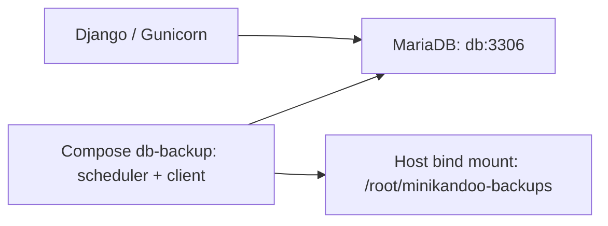

# عملیات بکاپ دیتابیس production

سرویس `db-backup` همراه وب/Gunicorn، Nginx، MariaDB، Redis و Certbot در **همان production Compose project** تعریف شده است. میزبان پوشهٔ پایدار را فراهم می‌کند و کانتینر، زمان‌بندی، dump، اعتبارسنجی و retention را انجام می‌دهد. هیچ cron، systemd timer، Docker socket، پورت عمومی یا دیتابیس دوم برای بکاپ ایجاد نمی‌شود. این سند دستورهای مسئول استقرار است؛ فعال‌بودن بکاپ روی VPS باید پس از استقرار جداگانه تأیید شود.

## معماری و مجوزها



`docker/backup/Dockerfile` بر image رسمی MariaDB 11.4.13 با digest ثابت ساخته می‌شود. Python، gzip، coreutils و util-linux وابستگی‌های اعلام‌شدهٔ build هستند؛ چیزی هنگام startup از اینترنت دانلود نمی‌شود. entrypoint اصلی server با `scripts/db_backup.py schedule` جایگزین است. تنها MariaDB client اجرا می‌شود. بسته‌های توزیع ممکن است در rebuild به‌روزرسانی امنیتی بگیرند؛ image ساخته‌شده را پیش از استقرار بازبینی کنید.

سرویس فقط به `db` با health condition وابسته و در `shop-net` داخلی است؛ وابستگی به web یا حلقهٔ وابستگی ندارد. `restart: unless-stopped`، root filesystem خواندنی، `cap_drop: ALL`، `no-new-privileges` و `/tmp` محدود با `noexec/nosuid/nodev` دارد. پوشهٔ `/backups` تنها محل پایدار نوشتن است. فایل‌ها داخل writable layer دیتابیس ذخیره نمی‌شوند.

image رسمی یک `VOLUME /var/lib/mysql` موروثی دارد. Compose این مسیرِ بلااستفاده برای client را با tmpfs خواندنی می‌پوشاند تا هیچ anonymous data volume برای worker ایجاد نشود. server اجرا یا دیتابیس تازه‌ای در این مسیر ساخته نمی‌شود؛ bind mount بکاپ مستقل باقی می‌ماند.

تنظیمات نمونه، **فقط کلیدهای لازم را به فایل موجود اضافه کنید**؛ فایل محیط production را با نمونه جایگزین نکنید:

```env
BACKUP_HOST_DIR=/root/minikandoo-backups
BACKUP_UID=0
BACKUP_GID=0
BACKUP_RETENTION_RECENT=48
BACKUP_RETENTION_DAILY_DAYS=7
BACKUP_RETENTION_MODE=dry-run
BACKUP_MAX_TOTAL_BYTES=
BACKUP_MIN_FREE_BYTES=
BACKUP_NON_TRANSACTIONAL_POLICY=refuse
BACKUP_COMMAND_TIMEOUT_SECONDS=1200
```

پوشهٔ فعلی و بکاپ‌های root-owned دست‌نخورده می‌مانند؛ هیچ chown بازگشتی انجام نمی‌شود. UID/GID صفر برای خواندن/نوشتن بکاپ‌های خصوصی موجود است، با تمام capabilityها حذف‌شده. برای مالکیت متفاوت، UID/GID را مطابق مالک واقعی انتخاب کنید. bind mount دارای `create_host_path: false` است؛ مسیر اشتباه خودکار به پوشهٔ خالی تبدیل نمی‌شود.

قبل از فعال‌سازی، metadata مسیر را بررسی کنید:

```sh
stat -c '%a %U:%G %n' /root/minikandoo-backups
stat -c '%s %a %U:%G %n' /root/minikandoo-backups/db-20261114-190647.sql.gz
df -B1 /root/minikandoo-backups
du -sb /root/minikandoo-backups
scripts/compose-production config --quiet
scripts/compose-production ps --all
```

اگر پوشه واقعاً وجود ندارد، فقط همان پوشه را با mode `0700` ایجاد کنید؛ بکاپ‌ها و مجوزهای موجود را تغییر ندهید. اطلاعات محیط و rendered config کامل credential دارند؛ آن‌ها را در logs یا گزارش عمومی قرار ندهید. wrapper به ریشهٔ مخزن می‌رود، فقط base و production Compose و `.env.production` را می‌خواند؛ development override وارد نمی‌شود. `ENV_FILE` فقط برای محیط آزمایشی یا مسیر خصوصیِ بازبینی‌شده قابل override است. project name موجود را تغییر ندهید.

## برنامهٔ دقیق نیم‌ساعته

Python scheduler داخل کانتینر:

1. پس از شروع سرویس و سالم‌شدن DB، یک بکاپ اولیه انجام می‌دهد.
2. tick بعد را به مرز بعدی UTC محاسبه می‌کند: `00:00`، `00:30`، `01:00`، `01:30` و ادامه؛ فاصلهٔ tickها ۱۸۰۰ ثانیه است.
3. بعد از هر attempt تا مرز بعدی صبر می‌کند؛ initial backup ممکن است خارج از مرز باشد. attempt طولانی موجب اجرای همزمان یا صف انباشتهٔ tickهای ازدست‌رفته نمی‌شود.
4. failure را log و در مرز بعد دوباره تلاش می‌کند؛ خرابی یک dump scheduler را متوقف نمی‌کند.
5. SIGTERM/SIGINT انتظار را قطع و clientهای فعال را متوقف می‌کنند؛ فایل نیمه‌کاره completed منتشر نمی‌شود. بعد از restart یک initial backup تازه انجام می‌شود.

هنگام خاموش‌بودن کانتینر، بکاپ جدیدی ساخته نمی‌شود. tickهای ازدست‌رفته backfill نمی‌شوند؛ با برگشت سرویس initial backup و مرز بعد ادامه می‌یابد. تغییر ساعت در انتظارهای کوتاه بررسی می‌شود؛ تنظیم ساعت میزبان باید صحیح باشد. از timer/cron میزبان برای این scheduler استفاده نکنید.

## dump سازگار و credential

پیش از هر dump، `information_schema.TABLES` engine، تعداد جدول و bytes واقعی schema را می‌خواند. برای تمام جدول‌های InnoDB:

```text
mariadb-dump --single-transaction --quick --routines --events --triggers --hex-blob
```

برای هر engine دیگر، سیاست پیش‌فرض **refuse** است؛ dump ناسازگار completed نمی‌شود. تنها پس از بررسی مسئول دیتابیس، `BACKUP_NON_TRANSACTIONAL_POLICY=lock-all` اجازهٔ `--lock-all-tables` می‌دهد. این حالت می‌تواند نویسنده‌های DB را مسدود کند و باید با اندازه و رفتار واقعی schema بررسی شود. به‌صورت خودکار engine تبدیل یا grant جدید اعمال نمی‌شود.

سرویس از root password موجود MariaDB استفاده می‌کند تا routine/event و در صورت نیاز consistency lock قابل خواندن باشند. فقط نام/host/port و credential دیتابیس را می‌گیرد؛ merchant و secret برنامه به آن نمی‌رسند. password در option file موقت `0600` داخل `/tmp` قرار دارد؛ در argv clientها یا logs نیست. محیط childها فقط PATH/locale/UTC دارد. `mariadb-dump` گزینهٔ `--connect-timeout` SQL client را پشتیبانی نمی‌کند؛ deadline کلی worker اتصال، dump و compression را محدود می‌کند.

`--single-transaction` حفاظت از DDL همزمان نمی‌دهد. migration، ALTER/DROP و تغییر engine را هنگام dump اجرا نکنید. در maintenance window، scheduler را با اجازهٔ استقرار کنترل و قبل از migration بکاپ دستی معتبر تهیه کنید. اندازه و engineهای production در این محیط بررسی نشده‌اند؛ نتیجهٔ schema مصنوعی QA جایگزین آن نیست.

## نام‌گذاری و انتشار فایل معتبر

هر attempt نام UTC یکتا دارد:

```text
db-YYYYMMDDTHHMMSSZ-<12 lowercase hex>.sql.gz
db-YYYYMMDDTHHMMSSZ-<12 lowercase hex>.sql.gz.sha256
```

مثال: `db-20261115T083000Z-a81f2c9b304e.sql.gz`. suffix تصادفی و publication بدون overwrite از collision جلوگیری می‌کنند. timestamp نام، شروع attempt است؛ زمان completion جداگانه در log می‌آید.

فرایند تحت قفل پوشه انجام می‌شود:

1. dump و gzip streaming در فایل خصوصی `.partial` روی همان filesystem؛ exit هر دو باید موفق باشد.
2. خروجی غیرخالی، `gzip -t` و خواندن کامل gzip تا EOF؛ SQL خالی با gzip سالم نیز رد می‌شود.
3. SHA256 و sidecar موقت، flush/fsync و مقایسهٔ digest واقعی با مقدار sidecar.
4. publication اتمیک بدون overwrite با hard link در همان filesystem: sidecar اول، dump completed آخر.
5. بررسی دوبارهٔ checksum فایل نهایی و fsync پوشه؛ سپس partialهای همان attempt حذف می‌شوند.

نام completed فقط بعد از validation ظاهر می‌شود. فایل ناقص recovery point نیست. خرابی dump/compression/checksum/publication exit غیرصفر دارد؛ attempt قبلی موفق حذف نمی‌شود. crash در میانه ممکن است partial یا sidecar بدون dump باقی بگذارد؛ آن‌ها valid شمرده نمی‌شوند و backup قبلی محفوظ است.

## retention و dry-run اولیه

سیاست فعال‌شده با `BACKUP_RETENTION_MODE=apply`، بعد از هر **بکاپ موفق**:

- تازه‌ترین ۴۸ بکاپ معتبر را نگه می‌دارد.
- آخرین بکاپ موفق هر یک از **۷ روز تقویمی UTC قبلی** را هم نگه می‌دارد؛ امروز جزو آن ۷ روز نیست.
- هم‌پوشانی فقط یک بار شمرده می‌شود؛ در حالت معمول حدود ۴۸ تا ۵۴ فایل dump باقی می‌ماند.
- اگر recent و daily هیچ هم‌پوشانی نداشته باشند، اجرای دقیق این سیاست تا ۵۵ فایل نگه می‌دارد؛ روز تقویمی از دست نمی‌رود. حفاظت فایل‌های future-dated نیز می‌تواند موقتاً تعداد را بیشتر کند.
- حتی با تنظیم recent کوچک، newest و یک previous معتبر در صورت وجود محفوظ‌اند؛ فایل future-dated هنگام عقب‌رفتن ساعت هم محافظت می‌شود.

تنها regex دقیق نام بالا کاندید است. legacy backupها، فایل unrelated، symlink، بکاپ با checksum ناموجود/خراب و نام‌های قدیمی پاک نمی‌شوند. **`/root/minikandoo-backups/db-20261114-190647.sql.gz` هرگز کاندید retention این سرویس نیست.** invalid sidecar به‌معنای recovery point نیست؛ در `invalid_preserved` گزارش می‌شود و به‌طور خودکار checksum تازه برای معتبر جلوه‌دادنش ساخته نمی‌شود.

dump و sidecar زیر همان lock به‌صورت pair حذف می‌شوند. shared lock بازیابی مانع cleanup است. partialهای دارای الگوی دقیق service و عمر بیش از ۲۴ ساعت، تنها وقتی هیچ backup فعال lock ندارد، قابل پاکسازی‌اند. partialهای جدید، foreign و symlink دست‌نخورده می‌مانند. قبل از attempt هم partialهای stale در حالت apply پاک می‌شوند تا failureهای قدیمی فضا را قفل نکنند؛ این مسیر هیچ بکاپ معتبر را حذف نمی‌کند.

پیش‌فرض **dry-run** برای بازبینی اولیه است. تا وقتی مسئول نتیجه را بررسی و `apply` را تنظیم نکرده، retention حذف واقعی ندارد و رشد پوشه باید پایش شود. preview:

```sh
scripts/compose-production run --rm --no-deps -T db-backup retention --dry-run
scripts/compose-production run --rm --no-deps -T db-backup inspect
```

`retained`، `delete`، `invalid_preserved`، `stale_partials`، bytes فعلی، bytes قابل آزادسازی و available bytes گزارش می‌شوند. `inspect` علاوه بر preview، engine و اندازهٔ DB و capacity estimate را می‌خواند. فرمان اول DB را تغییر نمی‌دهد و دوم نیز صرفاً inquiry خواندنی است. قبل از اولیهٔ destructive cleanup، این خروجی روی **production واقعی** بازبینی شود. برای فعال‌سازی پس از اجازهٔ استقرار:

```sh
# ابتدا BACKUP_RETENTION_MODE=apply را در فایل محیط موجود تنظیم کنید.
scripts/compose-production up -d --no-deps db-backup
scripts/compose-production logs --tail=100 db-backup
```

واحد آزمون با صدها فایل مصنوعی deletion/overlap را آزمایش می‌کند؛ dry-run روی VPS در این محیط انجام نشده است.

## ظرفیت دیسک

`BACKUP_MAX_TOTAL_BYTES` سقف کل پوشه و `BACKUP_MIN_FREE_BYTES` حداقل فضای آزاد، به bytes هستند. مقدار خاص VPS حدس زده نشده و نمونه خالی است. پیش از انتخاب مقدار، `inspect`، اندازهٔ بکاپ‌های واقعی، uncompressed bytes، compression ratio و فضای filesystem را بررسی کنید. ظرفیت باید حداقل فضای بکاپ تازه در کنار recovery pointهای نگهداری‌شده و فایل‌های تاریخی را هم فراهم کند.

در حالت خالی، تخمین attempt از بیشینهٔ دو برابر bytes واقعی جدول‌ها و اندازهٔ SQL بازشدهٔ بکاپ‌های قبلی گرفته می‌شود؛ expansion دادهٔ binary و overhead باید جداگانه بررسی شود. reserve آزاد پیش‌فرض برابر همان تخمین است. این یک estimate عملیاتی است و تضمین حداکثر اندازهٔ SQL نیست. free space و سقف پوشه قبل، حین و بلافاصله پس از dump بررسی می‌شوند؛ failure ظرفیت completed منتشر نمی‌کند.

مصرف فایل‌های historical، unrelated و partial در سقف حساب می‌شود، اما برای بازکردن فضا خودکار حذف نمی‌شوند. اگر limit پیش از dump مانع attempt شد، بکاپ‌های خوب برای عبور از سقف قربانی نمی‌شوند؛ مسئول باید dry-run retention را بررسی و limit/فضا را اصلاح کند. headroom ناکافی می‌تواند مانع ساخت بکاپ بعدی شود. در حالت apply، retention پس از success مانع رشد نامحدود فایل‌های managed می‌شود؛ دادهٔ historical/invalid نیاز به بررسی انسانی دارد.

## قفل و اجرای دستی

`.db-backup.lock` در bind mount پایدار، با `flock` exclusive و nonblocking حفاظت می‌شود. آن را حذف نکنید؛ تمام کانتینرها باید همان inode را قفل کنند. schedule، manual one-off، retention و stale cleanup مشترک‌اند. `operation_busy` و exit `75` یعنی فرآیند دیگری lock دارد؛ بعد از اتمام آن retry کنید. یک deploy/recreate فایل‌های host را از بین نمی‌برد.

دستور دستی دقیق:

```sh
scripts/backup-production-db
# معادل مستقیم، از همان wrapper و implementation:
scripts/compose-production run --rm --no-deps -T db-backup backup
```

wrapper دستی آرگومان directory نمی‌پذیرد؛ مسیر فقط از bind mount بررسی‌شده است. DB باید از قبل healthy باشد؛ `--no-deps` سرویس production را ناخواسته recreate نمی‌کند. خروج غیرصفر را بررسی و نام دقیق `backup_completed` را انتخاب کنید. این اجرا lock، naming، validation و retention همان scheduler را دارد.

## بررسی فایل و مانیتورینگ

```sh
scripts/compose-production ps
scripts/compose-production config --quiet
scripts/compose-production logs --tail=200 db-backup
scripts/compose-production exec -T db-backup python3 /opt/minikandoo/db_backup.py healthcheck
```

healthcheck به heartbeat زنده و آخرین attempt موفق و success کمتر از یک ساعت وابسته است. Docker restart policy مرگ فرآیند را پوشش می‌دهد؛ **unhealthy بودن به‌تنهایی restart خودکار نمی‌دهد**. scheduler زنده پس از failure در tick بعد تلاش می‌کند. one-off دستی health scheduler را به‌جای آن ثبت نمی‌کند.

برای مشاهدهٔ فایل‌ها و بررسی conventional SHA256/gzip داخل سرویس:

```sh
scripts/compose-production run --rm --no-deps -T --entrypoint sh db-backup -c 'ls -lh /backups'
BACKUP_NAME=NEW_BACKUP_FILENAME.sql.gz
scripts/compose-production run --rm --no-deps -T --entrypoint sh db-backup -eu -c '
cd /backups
sha256sum --check -- "$1.sha256"
gzip -t -- "$1"
' sh "$BACKUP_NAME"
```

نام placeholder را با completed واقعی عوض کنید. sidecarهای جدید basename دارند؛ sidecar legacy با مسیر مطلق host ممکن است در کانتینر با `sha256sum -c` حل نشود. validator امن پروژه basename را تطبیق و **همان فایل انتخابی** را hash می‌کند:

```sh
scripts/compose-production run --rm --no-deps -T --entrypoint python3 db-backup -c '
import sys
from pathlib import Path
sys.path.insert(0, "/opt/minikandoo")
import db_backup as b
p = Path("/backups") / sys.argv[1]
with b.protect_recovery_backup(p):
    digest = b.verify_backup_checksum(p)
    size = b.verify_gzip(p)
    print({"filename": p.name, "sha256_verified": True, "uncompressed_bytes": size})
' "$BACKUP_NAME"
```

logs شامل start/completion UTC، filename، اندازهٔ compressed/SQL، نتیجهٔ checksum، مصرف پوشه/فضای آزاد، counts retention و دلیل امن failure هستند. database contents، customer data، password و env چاپ نمی‌شوند. exit `1` failure و exit `75` busy است. `backup_completed` همراه checksum معتبر یک recovery point است؛ تنها وجود فایل یا پیام شروع کافی نیست.

## restore در محیط جداگانه

SHA256 و gzip سالم فقط سلامت فایل را ثابت می‌کنند؛ SQL ممکن است به privilege، نسخه، collation یا routine/event نیاز داشته باشد. restore واقعی جداگانه باید انجام شود. آزمون آمادهٔ محلی، source و target مصنوعی و tmpfs می‌سازد، بدون volume production:

```sh
.venv/bin/python scripts/qa/test_backup_stack.py
# فقط Docker/restore، پس از اجرای suite اصلی:
.venv/bin/python scripts/qa/test_backup_stack.py --skip-django-tests
```

این driver همهٔ عملیات stack را با `scripts/compose-production` و project یکتا انجام می‌دهد؛ target restore کانتینر QA مستقل با data tmpfs است. جدول‌های Django، مقادیر نمونه، routine، trigger و event پس از SQL import بررسی می‌شوند. پاکسازی فقط کانتینرها/شبکه‌های همان QA است؛ هیچ Docker volume حذف نمی‌شود. artifacts خصوصی فقط synthetic data دارند و به سرویس بیرونی upload نمی‌شوند. این تست، restore **فایل واقعی production** نیست.

برای restore یک بکاپ واقعی روی همان Docker host، target و شبکهٔ کاملاً مستقل بسازید و فقط backup را read-only mount کنید. منابع RAM/disk متناسب با اندازهٔ اندازه‌گیری‌شده لازم‌اند. مثال زیر باید روی محیط آزمایشی بازبینی‌شده اجرا شود؛ DB target هیچ اتصال به شبکهٔ production ندارد:

```sh
BACKUP_HOST_DIR=/root/minikandoo-backups
BACKUP_NAME=NEW_BACKUP_FILENAME.sql.gz
RESTORE_DATABASE=clothing_shop
restore_token=$(python3 -c 'import secrets; print(secrets.token_hex(6))')
restore_network="minikandoo-restore-$restore_token"
restore_container="minikandoo-restore-db-$restore_token"
restore_env=$(mktemp)
chmod 600 "$restore_env"
backup_image=$(scripts/compose-production images -q db-backup)
test -n "$backup_image"
python3 - "$restore_env" "$restore_container" "$RESTORE_DATABASE" <<'PY'
from pathlib import Path
import secrets, sys
password = secrets.token_urlsafe(32)
Path(sys.argv[1]).write_text(
    "MARIADB_ROOT_PASSWORD=" + password + "\nDATABASE_PASSWORD=" + password
    + "\nDATABASE_USER=root\nDATABASE_HOST=" + sys.argv[2]
    + "\nDATABASE_NAME=" + sys.argv[3] + "\nDATABASE_PORT=3306\nBACKUP_DIRECTORY=/backups\n"
)
PY
docker network create --internal "$restore_network"
docker run -d --name "$restore_container" --label "minikandoo.restore-test=$restore_token" \
  --network "$restore_network" --env-file "$restore_env" \
  --tmpfs /var/lib/mysql:rw,nosuid,nodev \
  --health-cmd 'healthcheck.sh --connect --innodb_initialized' \
  --health-interval 5s --health-start-period 30s \
  mariadb:11.4@sha256:1292844148b311e4ed4300022a996d39083f415a963e970cf47cad1b3b18e3a6 \
  --character-set-server=utf8mb4 --collation-server=utf8mb4_unicode_ci
docker inspect --format '{{.State.Health.Status}}' "$restore_container"
```

تا healthy شدن target منتظر بمانید. `RESTORE_DATABASE` باید نام schema header همان dump باشد. command بعد فقط داخل شبکهٔ جداگانه و با password مصنوعی target کار می‌کند؛ روی DB زنده اجرا نشود:

```sh
docker run --rm -i --network "$restore_network" --env-file "$restore_env" \
  --mount "type=bind,source=$BACKUP_HOST_DIR,target=/backups,readonly" \
  --read-only --tmpfs /tmp:rw,nosuid,nodev,noexec,size=16m \
  --tmpfs /var/lib/mysql:ro,nosuid,nodev,noexec \
  --cap-drop ALL --security-opt no-new-privileges \
  --entrypoint python3 "$backup_image" - "$BACKUP_NAME" <<'PY'
import gzip, shutil, subprocess, sys
sys.path.insert(0, "/opt/minikandoo")
import db_backup as b
c = b.Config.from_env()
p = c.directory / sys.argv[1]
with b.protect_recovery_backup(p), b.client_options(c) as options:
    b.verify_backup_checksum(p)
    b.verify_gzip(p)
    create = subprocess.run(
        ["mariadb", "--defaults-file=" + str(options)],
        input=("CREATE DATABASE `" + c.database.replace("`", "``")
               + "` CHARACTER SET utf8mb4;\n").encode(),
        stdout=subprocess.DEVNULL, stderr=subprocess.DEVNULL, env=b.client_environment(),
    )
    if create.returncode:
        sys.exit("Isolated database creation failed.")
    with gzip.open(p, "rb") as source:
        proc = subprocess.Popen(
            ["mariadb", "--defaults-file=" + str(options), c.database],
            stdin=subprocess.PIPE, stdout=subprocess.DEVNULL, stderr=subprocess.DEVNULL,
            env=b.client_environment(),
        )
        try:
            shutil.copyfileobj(source, proc.stdin)
        finally:
            proc.stdin.close()
        if proc.wait():
            sys.exit("Isolated SQL restore failed.")
    result = subprocess.run(
        ["mariadb", "--defaults-file=" + str(options), "--batch", "--skip-column-names", c.database],
        input=b"SELECT COUNT(*) FROM payments_payment; SELECT COUNT(*) FROM orders_order; SELECT COUNT(*) FROM products_productvariant;\n",
        stdout=subprocess.PIPE, stderr=subprocess.DEVNULL, env=b.client_environment(),
    )
    if result.returncode:
        sys.exit("Isolated restored-schema check failed.")
    print("Isolated SQL restore completed; payment/order/variant row counts:")
    print(result.stdout.decode("ascii"))
PY
```

counts را با snapshot مجاز source، migration state، routines/triggers/events و قواعد مالی/موجودی مقایسه کنید. هیچ اطلاعات مشتری در گزارش عمومی نگذارید. پس از بررسی، label همان test را تأیید و فقط همان target را جمع کنید:

```sh
test "$(docker inspect --format '{{index .Config.Labels "minikandoo.restore-test"}}' "$restore_container")" = "$restore_token"
docker stop "$restore_container"
docker rm "$restore_container"
docker network rm "$restore_network"
rm -- "$restore_env"
```

data target در tmpfs است؛ هیچ volume production در این دستورها mount یا حذف نمی‌شود. یک restore موفق را با نام بکاپ، digest، نسخهٔ MariaDB، زمان و نتایج بررسی خصوصی ثبت کنید.

## restore production فقط با تأیید صریح انسان

restore زنده عملیات جایگزینی داده است؛ در این کار انجام نمی‌شود. مسئول باید پیش از آن: علت حادثه و recovery point را تأیید کند، بکاپ تازهٔ وضعیت فعلی را حفظ کند، maintenance window و توقف تمام writerها را هماهنگ کند، checksum/gzip و restore آزمایشی همان فایل را بررسی کند، و برنامهٔ بازگشت و source/image/migration سازگار را تصویب کند.

فقط پس از اجازه، از همان wrapper برای توقف کنترل‌شدهٔ web و backup scheduler و اجرای client با option file خصوصی استفاده شود. برای restore زنده، حساب/نام DB واقعی باید جداگانه توسط مسئول تأیید شود؛ دستور target مصنوعی بالا را با جایگزینی عجولانهٔ network روی production اجرا نکنید. پس از import، schema، ledger، سفارش‌ها/رزروها و readiness را بررسی، سپس نویسنده‌ها و `db-backup` را برگردانید. موفقیت gzip/checksum یا exit import به‌تنهایی اثبات سلامت تجارت نیست. هیچ `down -v`، حذف volume یا حذف بکاپ‌های قبلی لازم نیست.

## عیب‌یابی و محدودیت

| نشانه | اقدام |
| --- | --- |
| `operation_busy` / exit 75 | backup/recovery/retention فعال را تمام کنید؛ lock file را حذف نکنید |
| `backup_failed` یا unhealthy | دلیل امن log، اتصال داخلی DB و زمان success را بررسی کنید؛ scheduler tick بعد retry می‌کند |
| directory unreadable | bind path و owner/mode و UID/GID را بررسی کنید؛ historical files را خودکار chown نکنید |
| non-InnoDB | engine واقعی را بررسی؛ policy lock-all فقط با تصمیم مسئول |
| capacity failure | bytes واقعی و dry-run را بازبینی؛ newest/previous و historical را حذف نکنید |
| checksum missing/mismatch | backup معتبر نیست؛ فایل را برای بررسی حفظ و recovery point سالم انتخاب کنید |
| partial قدیمی | فقط cleanup service زیر lock و threshold ۲۴ ساعت؛ فایل foreign حذف نشود |
| container crash/recreate | mount باقی می‌ماند؛ restart و initial backup و health را بررسی کنید |

بکاپ همان host در برابر بسیاری از خرابی‌های DB/حذف منطقی داده کمک می‌کند، اما **از نابودی کامل VPS یا دیسک محافظت نمی‌کند**. off-site رمزگذاری‌شده و بکاپ media گام‌های آینده‌اند. هیچ provider پولی، ارسال دادهٔ مشتری یا upload بکاپ بدون اجازه در این تغییر تنظیم نشده است.
